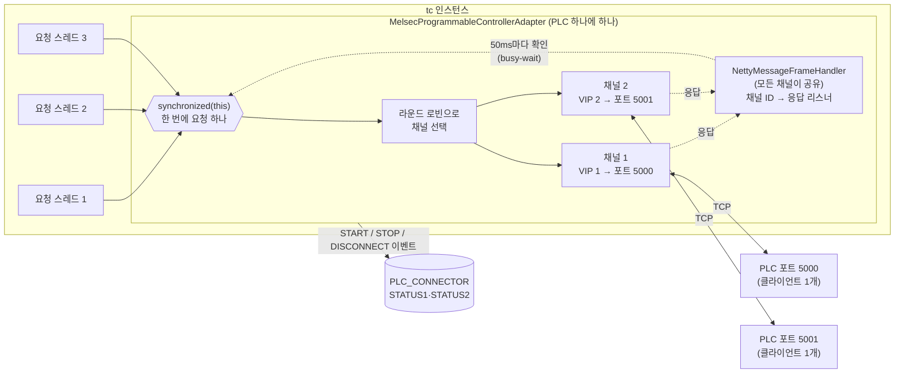
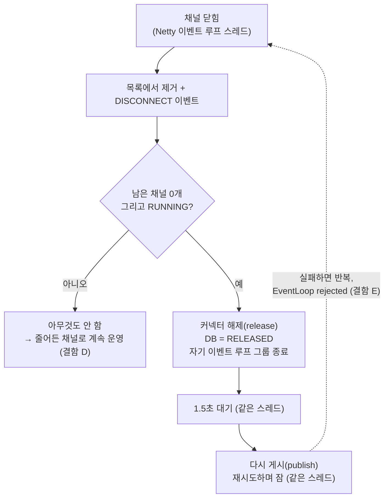
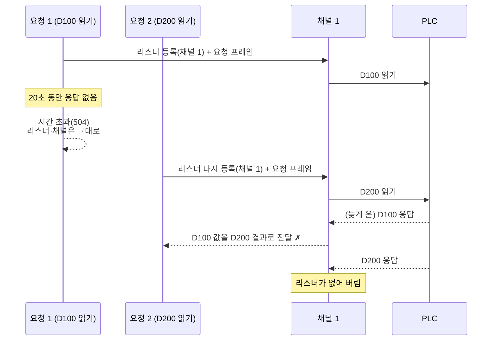
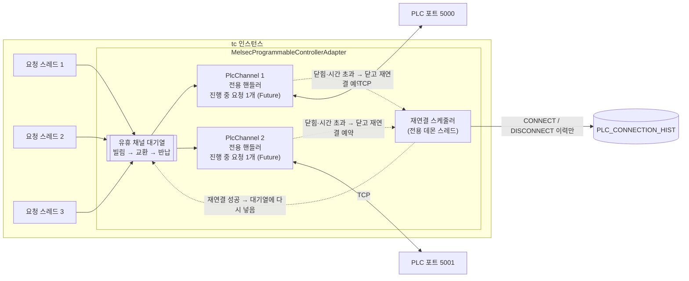
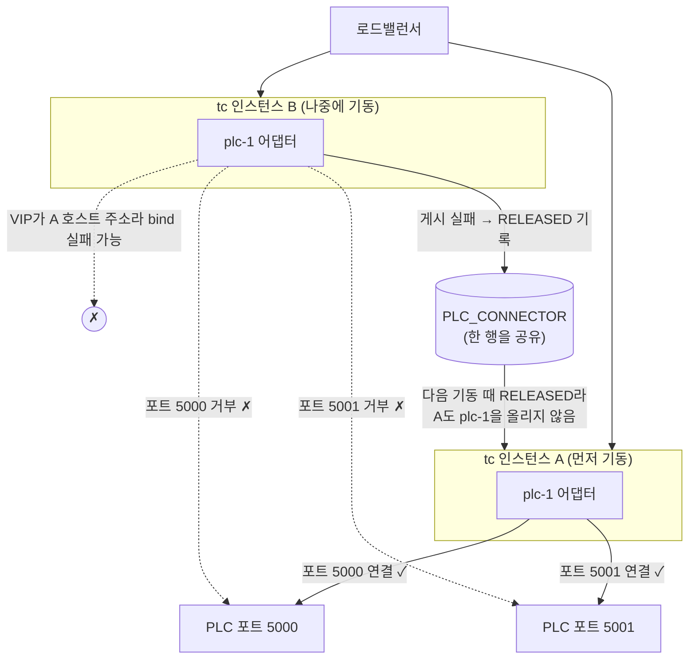
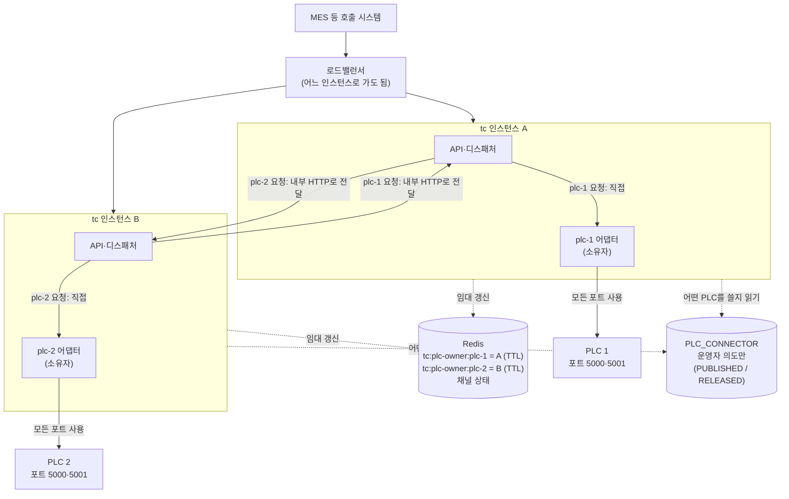
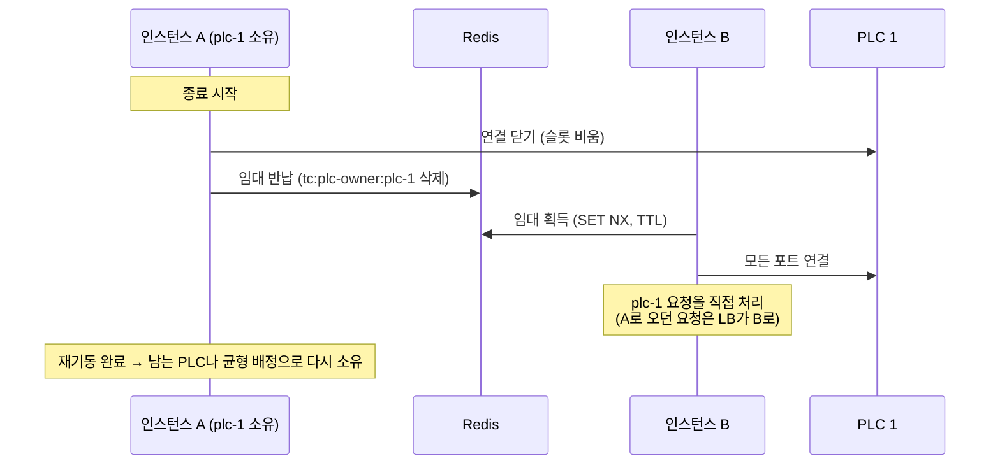

# PLC 연결 관리: 현재 구조 분석, 결함, 다중화 설계

> 상태(2026-10-30): §5 결함 수정은 구현하고 로컬에서 확인했다(§5.5). §6 다중화는 설계만 있다.
> 대상: `wow-tc-backend/tc`의 `com.wow.be.tc.plc` 패키지
> - `connector/melsec/MelsecProgrammableControllerAdapter`
> - `connector/melsec/NettyMessageFrameHandler`
> - `connector/PlcAdapterManager`
> - `management/PlcConnectionEventDbHandler`
> - `management/PlcConnectorLoader`
> - `management/impl/DefaultPlcConnectorManagementService`

## 1. 질문

1. tc 안에서 **PLC 하나에 어댑터 하나**가 연결을 유지하고, 요청이 오면 새로 연결하지 않고 그 어댑터를 부르는 구조가 맞는가?
2. tc를 **Active-Active**로 다중화했을 때, 한 인스턴스가 어떤 포트로 PLC에 연결해 있으면 다른 인스턴스는 다음 포트로 연결하는 방식은 어떤가?

## 2. 요약

- **질문 1: 방향은 맞다.** 다만 지금 구현에는 방향보다 급한 결함이 있다. 그중 가장 위험한 것은 **시간 초과 뒤 늦게 온 응답이 다음 요청의 결과로 처리되는 문제**(§4 A)다. 틀린 값이 조용히 성공으로 나간다.
- **질문 2: 지금 코드는 그렇게 동작하지 않는다.** 의도대로 구현하더라도 권하지 않는다. 권하는 구조는 "API는 Active-Active, PLC 연결은 PLC마다 소유 인스턴스 하나(임대 기반)"다(§6).
- **순서**: 결함 수정(§4)을 먼저 하고, 그 위에 다중화(§6)를 올린다.

## 3. 현재 구조



### 3.1 연결

- 커넥터를 게시(publish)하면 `PlcAdapterManager`가 어댑터 객체를 만들고 `ready()` → `start()` → `prepareNetwork()`를 부른다.
- `prepareNetwork()`는 `min(포트 수, 로컬 VIP 수)`개의 TCP 연결을 연다. i번째 연결은 `로컬 VIP i`에서 `PLC IP:포트 i`로 간다.
  - Netty `Bootstrap`을 쓰고, 옵션은 `TCP_NODELAY`, `SO_KEEPALIVE`, 연결 시간 초과 5초다.
  - 한 개라도 연결되면 성공이다. 하나도 안 되면 `plc.connection.retry.*` 설정(기본 10회, 1.5초씩 늘어나는 간격)대로 **재귀 호출로 다시 시도하며 그동안 호출 스레드를 붙잡는다.** 최악의 경우 약 82초다.
- 채널은 `channelFutures` 목록에 들어간다. 요청할 때 라운드 로빈으로 하나를 고른다.
- PLC 하나에 어댑터 하나다. 요청마다 새로 연결하지 않는다.

### 3.2 요청과 응답

- `readOrWrite()`의 흐름은 다음과 같다.
  1. 채널을 하나 고른다.
  2. 그 채널 ID로 응답 리스너를 등록한다.
  3. 요청 프레임을 보낸다.
  4. 응답이 오거나 20초가 지날 때까지 **50ms마다 깨어나 확인한다.**
- 이 전체가 `synchronized(this)` 안에 있다.
- 응답은 `NettyMessageFrameHandler`가 받는다. 이 핸들러는 **어댑터의 모든 채널이 함께 쓰는 하나**이고, 채널 ID로 리스너를 찾아 넘긴다. 리스너가 없으면 응답을 버린다.
- MC 3E 바이너리 프레임에는 요청과 응답을 짝지을 번호가 없다. 4E 프레임에는 시리얼 번호가 있다.

### 3.3 연결이 끊겼을 때

- 채널이 닫히면 `closeFuture` 리스너가 그 채널을 목록에서 빼고 `DISCONNECT` 이벤트를 낸다. 이 리스너는 **Netty 이벤트 루프 스레드**에서 돈다.
- `PlcConnectionEventDbHandler`는 이벤트를 이력 표에 남긴다.
  - **남은 채널이 0개**이고 운영 상태가 RUNNING일 때만 다시 연결한다.
  - 방식은 커넥터 전체를 해제(release)한 뒤 1.5초 기다렸다가 다시 게시(publish)하는 것이다.
  - 이 모든 일이 같은 이벤트 루프 스레드에서 일어난다.
- 채널이 일부만 끊기면 아무것도 하지 않는다.



### 3.4 상태 저장

- 커넥터의 `STATUS1`(PUBLISHED, RELEASED)과 `STATUS2`(RUNNING, STOPPED 등)는 `PLC_CONNECTOR` 표 한 행에 있다.
- `START` 이벤트는 이 행을 PUBLISHED·RUNNING으로, `STOP`·`SHUTDOWN` 이벤트는 RELEASED·STOPPED로 바꾼다. → 2026-10-31 없앴다: 이벤트는 이력과 Redis 연결 상태만 남긴다(plc-ha-design.md §3.4.1).
- 기동할 때 `PlcConnectorLoader`는 **STATUS1이 PUBLISHED인 커넥터만** 다시 올린다.

### 3.5 다중화 설정

- `application.yml`에 `oper.duplication.mode: active-standby`가 있다. 하지만 **이 값을 읽는 코드가 없다.**

## 4. 결함

| # | 결함 | 근거 | 영향 |
|---|---|---|---|
| **A** | **시간 초과 뒤 늦게 온 응답이 다음 요청의 결과가 된다** | 3E 프레임에 짝지을 번호가 없다. 시간 초과가 나도 리스너를 지우지 않고 채널도 그대로 쓴다. 다음 요청이 같은 채널에 리스너를 다시 등록한 뒤 이전 요청의 늦은 응답이 오면, 그 응답이 다음 요청의 결과로 처리된다 | **틀린 값이 성공으로 나간다.** 가장 위험하다 |
| **B** | 어댑터 전체가 한 번에 요청 하나만 처리한다 | `readOrWrite()` 전체가 `synchronized(this)` | 채널을 여러 개 열어도 병렬 처리가 안 된다. 요청 하나가 시간 초과되면 그 PLC의 **모든 요청이 최대 20초 멈춘다** |
| **C** | 응답을 50ms 간격으로 확인하며 기다린다 | `while (!arrived) sleep(50)` | 요청마다 최대 50ms 지연이 더해지고, 요청 스레드가 묶인다 |
| **D** | 일부 채널이 끊기면 다시 연결하지 않는다 | §3.3. 다시 연결하는 경우는 채널이 0개일 때뿐 | 채널 3개 중 1개가 끊기면 영영 2개로 운영된다 |
| **E** | 다시 연결하는 작업이 Netty 이벤트 루프 스레드에서 돈다 | 그 스레드가 자기 이벤트 루프 그룹을 종료(`shutdownNow`)하고, 재시도하며 잠을 잔다 | 로그에 `Can't invoke task later as EventLoop rejected it`가 남는다. 2026-10-30 로컬 시험에서는 재연결이 실패한 연결을 반복하다 커넥터가 RELEASED로 끝났다 |
| **F** | 이미 게시된 커넥터를 다시 게시하면 연결이 하나 더 열린다 | `loadProgrammableControllerAdapter()`가 새 어댑터를 만들어 맵에 덮어쓴다. 옛 어댑터는 멈추지 않는다 | 옛 연결이 남아 슬롯을 차지한다. 슬롯이 1개인 PLC에서는 새 연결이 거부되고 상태가 꼬인다. 2026-10-30 시험에서 겪었다 |
| **G** | 처음 연결할 때 호출 스레드를 오래 붙잡는다 | §3.1. 최악의 경우 약 82초 | 게시 API가 그동안 응답하지 않는다. 기동할 때는 그만큼 기동이 늦어진다 |
| **H** | 어댑터 목록이 스레드에 안전하지 않다 | `PlcAdapterManager`가 `HashMap`을 쓴다. 싱글턴 생성도 동기화되지 않았다 | 게시·해제와 요청이 동시에 일어나면 드물게 꼬일 수 있다 |
| **I** (추정) | 앱이 종료될 때 커넥터가 RELEASED로 기록될 수 있다 | 종료 중 채널이 닫히면 `DISCONNECT`(남은 0개)가 나서 §3.3의 해제·재게시가 돈다. 해제는 DB를 RELEASED로 바꾼다 | 다음 기동 때 로더가 그 커넥터를 올리지 않는다. 2026-10-30 시험에서 재기동 뒤 커넥터가 RELEASED였던 것과 맞는다. 재현으로 확인하지는 않았다 |

### 4.1 결함 A의 흐름



3E 프레임에는 요청과 응답을 짝지을 번호가 없어서, 어느 요청의 응답인지 구별할 수 없다.

### 4.2 연결 상태 확인

연결 상태 확인에 대한 참고:
- `SO_KEEPALIVE`는 운영체제 기본 간격이 2시간이라, 반쯤 끊긴 연결(케이블 단선, PLC 전원 차단)을 사실상 감지하지 못한다.
- 지금은 요청이 시간 초과가 나야 비로소 알 수 있다.

## 5. 결함 수정 설계



### 5.1 채널 단위 처리 (A, B, C)

- 연결 하나를 `PlcChannel` 객체로 감싼다. 이 객체가 가지는 것:
  - 포트와 로컬 VIP
  - 현재 Netty 채널
  - 진행 중인 요청의 `CompletableFuture<byte[]>`
  - 상태(연결됨, 끊김, 재연결 중)
- **채널마다 응답 핸들러를 따로 둔다.** 핸들러는 그 채널의 진행 중인 요청을 완료시킨다. 진행 중인 요청이 없는데 응답이 오면 경고 로그를 남기고 버린다.
- **유휴 채널 대기열**(`BlockingQueue<PlcChannel>`)을 둔다.
  - 요청은 쉬는 채널을 빌린다. 빌리는 데 기다리는 시간도 요청 시간 초과에 포함한다.
  - 교환이 끝나면 채널을 돌려준다.
  - 3E 프레임에서는 채널 하나에 진행 중인 요청이 하나뿐이어야 하므로, **직렬화 단위는 채널**이다. 채널이 N개면 N개 요청을 동시에 처리한다.
- **응답 대기는 `future.get(timeout)`으로 한다.** 응답이 오는 즉시 깨어난다.
- **시간 초과가 나면 그 채널을 닫고 다시 연결한다.** 늦은 응답은 닫힌 연결로 오므로 다른 요청에 섞일 수 없다. 이것이 A의 해결책이다.

  ```mermaid
  sequenceDiagram
      participant R1 as 요청 1
      participant R2 as 요청 2
      participant Q as 유휴 채널 대기열
      participant CH as 채널 1
      participant PLC
      R1->>Q: 채널 빌림 → 채널 1
      R1->>CH: Future 등록 + 요청 프레임
      CH->>PLC: D100 읽기
      Note over R1: 시간 초과
      R1->>CH: 채널 닫기 (대기열에 돌려주지 않음)
      R1-->>R1: 504
      Note over CH: 재연결 예약 → 새 TCP 연결 → 대기열에 다시 넣음
      R2->>Q: 채널 빌림 → (새 연결의) 채널 1 또는 채널 2
      R2->>CH: D200 읽기
      PLC-->>CH: D200 응답만 이 연결로 온다 ✓
  ```
  - 근본적으로는 4E 프레임(시리얼 번호)을 지원하는 것이다. 이는 별도 과제다.
- 시간 초과(기본 20초)는 설정값 `plc.request.timeout-ms`로 뺀다.

### 5.2 재연결 (D, E, G)

- 어댑터마다 **재연결 전용 스케줄러**(데몬 스레드 1개)를 둔다. Netty 이벤트 루프에서는 재연결 작업을 하지 않는다.
- **채널이 닫히면 그 채널만 다시 연결하도록 예약한다.**
  - 간격은 `plc.connection.retry.interval.rate`부터 시작한다(`increment`가 true면 회차마다 늘린다). 최대 30초다.
  - 어댑터가 멈추지 않는 한 **계속 시도한다.**
- 연결과 끊김 이벤트(`CONNECT`, `DISCONNECT`)는 이력에 남기기만 한다. `PlcConnectionEventDbHandler`의 해제·재게시 동작은 없앤다. **커넥터는 PUBLISHED 상태를 유지하고, 채널은 어댑터가 스스로 복구한다.**
- 이벤트 처리(DB 기록)도 재연결 스케줄러에서 한다. Netty 스레드에서 DB를 쓰지 않는다.
- **처음 게시할 때는 모든 채널에 한 번씩만 연결을 시도한다.**
  - 하나라도 연결되면 성공이다. 나머지는 백그라운드에서 다시 연결한다.
  - 하나도 안 되면 지금처럼 게시 실패(`ERR_503_TC_PLC_UNAVAILABLE`)로 끝낸다. 운영자가 PLC 주소가 틀렸는지 바로 알 수 있게 하기 위해서다.
  - 호출 스레드를 붙잡는 시간은 연결 시간 초과(5초) 정도로 줄어든다.
- **앱이 기동할 때(`PlcConnectorLoader`)는 다르게 한다.** PLC가 아직 꺼져 있어도 어댑터를 올리고 뒤에서 계속 연결을 시도한다(`startEvenIfDisconnected`).
  - 예전에는 재시도를 다 쓰면 로더가 **`System.exit(0)`으로 앱 전체를 종료했다.** PLC 한 대가 꺼져 있으면 tc가 뜨지 못했다.

### 5.3 게시와 종료 (F, H, I)

- **게시를 멱등으로 만든다.** 같은 이름의 어댑터가 이미 돌고 있으면 새로 만들지 않는다. 설정이 바뀌어 다시 올려야 한다면 해제한 뒤 게시한다.
- `PlcAdapterManager`의 목록을 `ConcurrentHashMap`으로 바꾸고, 싱글턴 생성을 안전하게 한다.
- **앱이 종료될 때는** `@PreDestroy`에서 모든 어댑터의 연결을 닫는다. 이때 **이벤트를 내지 않는다.** DB 상태는 PUBLISHED 그대로 두어 다음 기동 때 다시 올라오게 한다.
  - 연결을 먼저 닫으면 PLC 쪽 슬롯이 빨리 비므로, 다음 기동이나 다른 인스턴스가 바로 연결할 수 있다.

### 5.4 이번 범위에 넣지 않는 것

- **주기적인 연결 상태 확인**(N초마다 무해한 워드 하나를 읽어 확인): PLC 프레임 헤더(네트워크 번호 등)는 인터페이스 정의에 있고 커넥터에는 없다. 그래서 별도 설계가 필요하다.
- **4E 프레임 지원**
- **응답 길이 검증**(요청한 워드 수와 응답 데이터 길이 대조): 5.1에서 시간 초과 시 채널을 닫으면 섞일 경로가 없어지므로 보조 수단으로 미룬다.

### 5.5 구현과 확인 결과 (2026-10-30)

**바뀐 코드**

| 파일 | 내용 |
|---|---|
| `connector/melsec/MelsecChannel` (새 파일) | 연결 하나. 진행 중 요청의 Future, 전용 응답 핸들러 |
| `connector/melsec/MelsecProgrammableControllerAdapter` | 유휴 채널 대기열, 시간 초과 시 연결 닫기, 채널별 재연결 스케줄러, 이벤트를 스케줄러 스레드에서 처리, 종료용 `shutdownQuietly()` |
| `connector/melsec/NettyMessageFrameHandler`, `NettyResponse` | 삭제(공유 핸들러와 busy-wait) |
| `connector/ProgrammableControllerAdapter` | `shutdownQuietly()` 추가 |
| `connector/PlcAdapterManager` | `ConcurrentHashMap`, 게시 멱등, 연결에 성공해야 목록에 넣음, `shutdownAllQuietly()` |
| `management/PlcConnectionEventDbHandler` | DISCONNECT 때의 해제·재게시 제거(이력만 남김) |
| `management/PlcConnectorLoader` | 기동 때 PLC가 꺼져 있어도 올림, `@PreDestroy`에서 연결을 조용히 닫음 |
| `management/PlcConfig` 외 | `plc.request.timeout-ms`(기본 20000) |

**로컬 e2e**

가짜 PLC(`scratchpad/fakeplc/fake_plc.py`)로 시험했다. 이 가짜 PLC는 n번째 요청에 값 n으로 답하고, 지정한 요청은 늦게 답하거나 답한 뒤 연결을 끊는다. 포트당 연결은 1개만 받는다. tc의 PLC 시간 초과는 3초로 두었다.

| 시나리오 | 결과 |
|---|---|
| 요청 #2를 5초 늦게 답함 → tc는 3초에 504 | 통과 |
| 바로 다음 요청 #3이 **값 3**을 받음(늦은 응답 2가 섞이지 않음). 늦은 응답은 닫힌 연결로 가서 버려짐 | 통과(결함 A) |
| 가짜 PLC가 연결을 끊음 → 자동 재연결 → 다음 요청 200, 그동안 커넥터는 PUBLISHED | 통과(D, E) |
| 동시 6건 → 모두 200, 값이 서로 다르고 섞이지 않음(채널 1개에서 직렬화) | 통과(B, C) |
| 게시를 다시 해도 새 연결을 열지 않음 | 통과(F) |
| tc 재기동 → 두 커넥터 모두 PUBLISHED로 다시 올라와 요청 200 | 통과(I) |
| PLC가 꺼진 채 tc 기동 → 앱은 뜨고 요청은 503 → PLC가 켜지면 자동 연결 → 200 | 통과(G, 로더) |
| vplc 커넥터(`plc-e2e`)와 API 키 인증 e2e(39개 항목) 회귀 | 통과 |

**확인하지 않은 것**

- **채널이 여러 개일 때 실제 병렬 처리**: 시험한 PLC가 포트 1개뿐이었다.
- **정상 종료(`@PreDestroy`) 경로**: 시험 스크립트가 프로세스를 강제 종료하므로 이 경로를 타지 않았다. 강제 종료 뒤 재기동은 확인했다.
- **로컬 VIP가 여러 개인 환경**

## 6. 다중화(Active-Active)

> 이 절의 방향을 구현 수준으로 확정한 문서: [plc-ha-design.md](plc-ha-design.md) (2026-10-30)

### 6.1 지금 코드의 동작

질문 2에서 가정한 "다른 인스턴스는 다음 포트로" 동작은 **구현되어 있지 않다.**

- **인스턴스마다 모든 포트에 연결을 시도한다.** 실패한 포트는 경고 로그만 남기고 건너뛴다. 인스턴스끼리 포트를 나눠 갖는 조정은 없다.
- **먼저 뜬 인스턴스가 모든 포트를 가져간다.** 포트당 연결이 1개인 PLC라면 늦게 뜬 인스턴스는 연결을 하나도 얻지 못하고, 재시도를 다 쓰면 게시가 실패한다.
- **로컬 VIP는 tc 호스트의 IP다.** 같은 커넥터 설정으로는 다른 호스트에서 bind가 실패한다. 인스턴스별로 설정을 달리 줄 방법도 없다.
- **커넥터 상태가 공유 DB 한 행에 있다.** 인스턴스별 런타임 상태를 모든 인스턴스가 함께 쓰는 곳에 저장하는 셈이다.
  - B 인스턴스가 연결에 실패하면 RELEASED를 기록한다.
  - 그 뒤 A가 재기동하면 로더는 PUBLISHED만 올리므로 A도 그 PLC를 올리지 않는다.
  - **한 인스턴스의 실패가 다른 인스턴스로 번진다.**
- `oper.duplication.mode` 설정은 읽는 코드가 없다(§3.5).



### 6.2 "포트를 나눠 갖는" 방식에 대한 평가

의도대로 구현하더라도 권하지 않는다.

| 문제 | 설명 |
|---|---|
| 배정이 기동 순서에 달려 있다 | 어느 인스턴스가 어느 포트를 갖는지 재현하기 어렵고, 장애를 분석하기도 어렵다 |
| 장애 시 넘겨받는 장치가 없다 | 한 인스턴스가 죽으면 그 포트는 비지만 남은 인스턴스가 가져갈 계기가 없다. 결국 재시도와 조정이 필요하고, 그건 §6.3의 소유권 방식을 다시 만드는 일이다 |
| 같은 PLC에 두 곳이 쓴다 | 두 인스턴스가 같은 디바이스에 WRITE하면 순서가 보장되지 않는다 |
| PLC 슬롯을 나눠 먹는다 | 포트 수가 인스턴스 수보다 적으면 성립하지 않는다. 인스턴스마다 병렬도도 줄어든다 |
| 상태가 뒤섞인다 | §6.1의 공유 DB 상태 문제가 그대로 남는다 |

### 6.3 권고: API는 Active-Active, PLC 연결은 소유권 방식



계획된 재기동(A를 순차 재기동)할 때의 소유권 이전:



장애(A가 갑자기 죽음)일 때는 반납이 없으므로, 임대 TTL(예: 10초)이 지난 뒤 B가 획득한다. 그동안 plc-1 요청은 503이다.

- **PLC마다 소유 인스턴스를 정확히 하나 둔다.**
  - 임대(lease)는 Redis 키(예: `tc:plc-owner:{plcName}`, 값은 인스턴스 ID, TTL 10초)로 둔다. 소유자는 몇 초마다 갱신한다.
  - 소유자만 그 PLC에 연결한다. 그 PLC의 **모든 포트를 써서** 병렬 처리한다(§5.1 채널 풀).
- **소유자가 아닌 인스턴스로 온 요청은 소유자에게 넘긴다.**
  - 내부 HTTP로 넘기며, 인증은 인스턴스 간 비밀값으로 한다.
  - 비용은 내부 호출 한 번이다.
  - 앞단 로드밸런서는 요청 본문의 opcode → PLC 대응을 모르므로, 넘기는 일은 tc 안에서 한다.
- **PLC들을 인스턴스에 나눠 배정해** 부하를 분산한다. 처음에는 "먼저 임대를 잡은 쪽"으로 해도 되고, 나중에 균형 배정을 더한다.
- **장애 시**: 임대가 만료되는 몇 초 뒤 다른 인스턴스가 소유권을 가져가 연결한다.
- **계획된 재기동 시**: 종료 전에 임대를 반납하고 연결을 먼저 닫는다(§5.3). 다른 인스턴스가 곧바로 연결하므로, 끊김이 몇 초의 재연결로 줄어든다. **"tc를 재기동하면 MES 등이 멈출 수 있다"는 문제의 근본 대책이 된다.**
- **상태를 둘로 나눈다.**

  | 상태 | 저장 위치 | 예 |
  |---|---|---|
  | 운영자의 의도 | DB `PLC_CONNECTOR` | 이 PLC를 쓸 것인가(PUBLISHED, RELEASED) |
  | 인스턴스별 연결 상태 | Redis(또는 메모리) | 누가 소유하는가, 채널이 몇 개 살아 있는가, 마지막 오류 |

  이렇게 나누면 한 인스턴스의 실패가 다른 인스턴스로 번지지 않는다. 화면은 두 상태를 함께 보여 준다.
- **스케줄 Job**: Quartz 클러스터가 Job을 아무 인스턴스에서나 실행해도, Job이 위 요청 전달 경로를 타므로 문제없다.
- **변경 감지 상태**(`PlcResponseService`)는 이미 Redis에 있어 인스턴스가 바뀌어도 이어진다.

### 6.4 확인해야 할 것

- **실제 PLC의 슬롯 해제 시간**: 연결을 닫은 뒤 PLC가 그 포트를 다시 받기까지 걸리는 시간이다. 소유권 이전 시간에 직접 영향을 준다.
- **인스턴스 간 전달 경로의 인증과 시간 초과**: 시간 초과는 전달받은 쪽의 PLC 시간 초과보다 길어야 한다.
- **로컬 VIP 설정**: 인스턴스별 값을 어디에 둘지 정해야 한다(인스턴스 설정이나 커넥터별 인스턴스 매핑).

## 7. 순서

1. **§5 결함 수정**: 단일 인스턴스에서도 틀린 값이 나가거나 연결이 영영 복구되지 않을 수 있다. 다중화보다 먼저다.
2. **§6 다중화**: 별도 설계를 확정한 뒤 구현한다. §5의 채널 풀, 재연결, 종료 처리가 그 기반이다.
