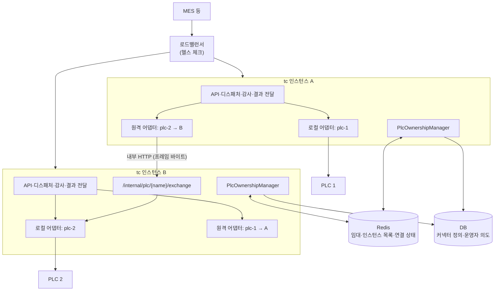
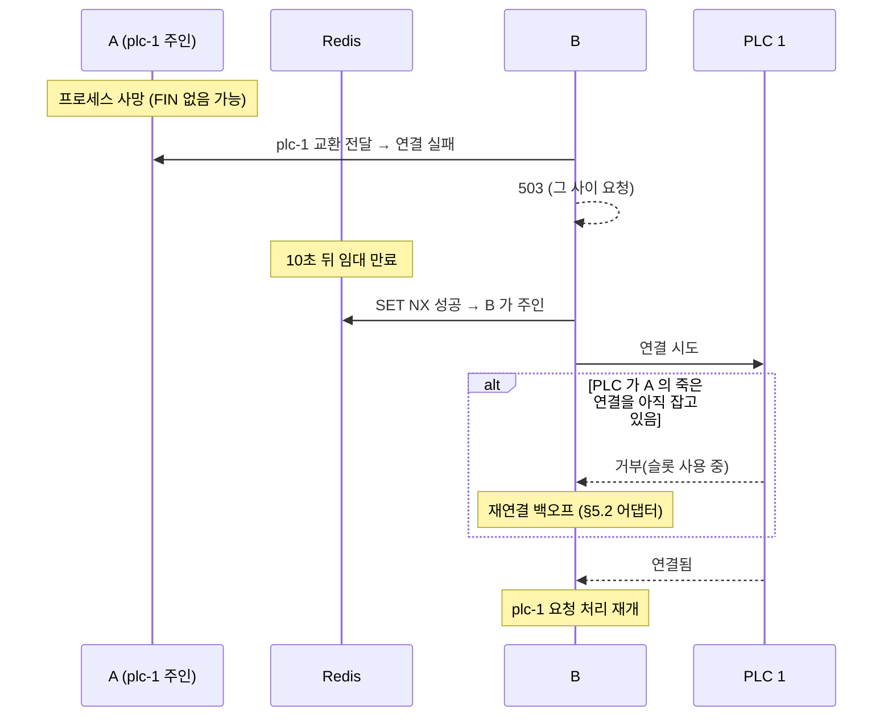
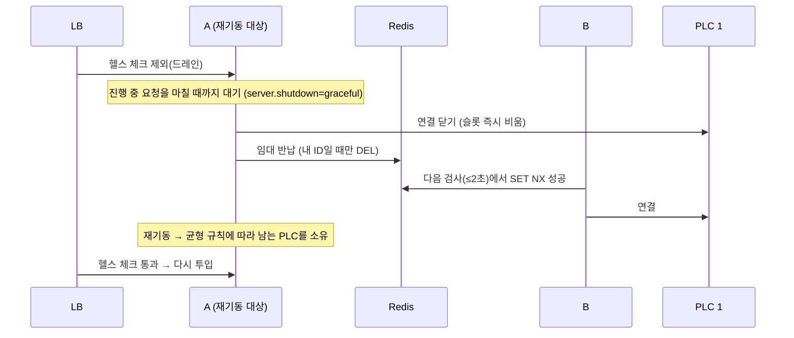

# PLC 연결 다중화(Active-Active) 설계

> 상태: 설계 확정안 (2026-10-30). 구현 전이다.
> 선행 문서: [plc-connection-design.md](plc-connection-design.md) §6(방향), §5(어댑터 결함 수정 — 이 설계의 기반)
> 대상: `wow-tc-backend/tc`

## 1. 목표와 범위

- **목표**
  - tc를 두 대 이상으로 운영해 **한 대가 죽거나 순차 재기동해도 PLC 요청이 몇 초 안에 이어지게** 한다.
  - "tc를 재기동하면 MES 등이 멈출 수 있다"는 운영 제약을 근본적으로 푼다.
- **원칙**
  - API는 Active-Active다. 어느 인스턴스로 요청이 와도 처리한다.
  - **PLC 연결은 PLC마다 소유 인스턴스가 정확히 하나**다. 같은 PLC에 두 인스턴스가 동시에 연결하지 않는다.
- **범위 밖**
  - DB와 Redis 자체의 이중화(인프라 영역)
  - 로드밸런서 제품 선택

## 2. 전체 구조



## 3. 핵심 결정

### 3.1 무엇을 넘기는가: PLC 교환만 넘긴다

- 요청을 받은 인스턴스가 디스패치, 감사, 결과 전달, 변경 감지를 **그대로 한다.** 소유 인스턴스로 넘기는 것은 **PLC 프레임 교환(요청 바이트 → 응답 바이트) 하나뿐**이다.
- 구현은 `ProgrammableControllerAdapter`를 하나 더 두는 것이다. `RemotePlcAdapter`가 `request(req, res)`에서 `req.convertRequest()`로 만든 바이트를 소유 인스턴스로 보내고, 받은 응답 바이트를 `res.splitHeaderAndReplyData()`에 넣는다.
  - 그러면 `PlcInterfaceCommand`, `PlcAdapterManager.get(name)`을 쓰는 코드는 바뀌지 않는다.
- **이렇게 정한 이유**
  - 감사의 `PRINCIPAL`, API 키 사용량 제한, 결과 전달이 요청을 받은 곳에서 한 번만 일어난다. 두 번 기록되거나 빠지지 않는다.
  - 넘기는 계약이 단순하다(바이트 → 바이트). 그래서 PLC 종류(MELSEC, 나중의 Modbus·OPC UA)와 무관하다.

### 3.2 소유권: Redis 임대

| 항목 | 값 |
|---|---|
| 키 | `tc:plc-owner:{plcName}` |
| 값 | `{instanceId}` |
| 획득 | `SET key instanceId NX PX 10000` (TTL 10초) |
| 갱신 | 3초마다. Lua로 "값이 내 ID일 때만 PEXPIRE" |
| 반납 | Lua로 "값이 내 ID일 때만 DEL" |
| 인스턴스 목록 | `tc:instance:{instanceId}` = `{내부 주소}`, TTL 10초, 3초마다 갱신 |

- **instanceId**: `{호스트명}-{기동 시각}`이다. 같은 호스트에서 재기동해도 다른 ID가 되므로, 옛 임대와 섞이지 않는다.
- **내부 주소**: `tc.instance.internal-url`(예: `http://10.0.1.11:8087`). 인스턴스마다 설정한다.

### 3.3 누가 무엇을 소유하는가

- `PlcOwnershipManager`가 2초마다 다음을 한다.
  1. DB에서 **운영자 의도가 PUBLISHED**인 커넥터 목록을 읽는다.
  2. 주인이 없는 PLC의 임대를 시도한다.
  3. 임대를 얻으면 그 PLC의 로컬 어댑터를 만들어 연결한다(§5 어댑터 그대로).
  4. 다른 인스턴스가 주인이면 그쪽을 가리키는 원격 어댑터를 둔다.
- **균형 규칙**: 살아 있는 인스턴스 수를 N, 게시된 PLC 수를 P라 할 때, 이미 `ceil(P/N)`개를 가진 인스턴스는 새 임대를 시도하지 않는다. 한 인스턴스가 기동하자마자 전부 가져가는 것을 막는다.
- **재균형은 자동으로 하지 않는다.** 소유권을 옮기면 짧은 끊김이 생기기 때문이다. 필요하면 관리자가 `POST /api/v1/plc-connector/{name}/handover`로 옮긴다(이력에 남김).

### 3.4 상태의 분리

| 상태 | 저장 위치 | 쓰는 쪽 |
|---|---|---|
| 운영자 의도(게시, 해제) | DB `PLC_CONNECTOR.STATUS1` | 관리 API만 |
| 소유자 | Redis `tc:plc-owner:{name}` | 소유권 관리자 |
| 연결 상태(살아 있는 채널 수, 마지막 오류, 마지막 연결 시각) | Redis `tc:plc-state:{name}` (해시, 소유자가 5초마다 갱신) | 소유자 |
| 연결·끊김 이력 | DB `PLC_CONNECTION_HIST`(지금 그대로) | 소유자 |

- **어댑터 이벤트는 더 이상 DB의 `STATUS1`을 바꾸지 않는다.** 한 인스턴스의 실패가 다른 인스턴스로 번지던 문제가 이것으로 없어진다(plc-connection-design.md §6.1).
- 화면의 커넥터 목록은 DB의 의도와 Redis의 소유자·연결 상태를 합쳐 보여 준다.

## 4. 인스턴스 간 전달

### 4.1 엔드포인트

```
POST /internal/plc/{plcName}/exchange
헤더: X-TC-Instance: {보낸 instanceId}
      X-TC-Signature: HMAC-SHA256(TC_INTERNAL_SECRET, plcName + "\n" + timestamp + "\n" + sha256(body))
      X-TC-Timestamp: {epoch ms}
본문: { "frame": "<base64>", "timeoutMs": 20000, "reqId": "..." }
응답: 200 { "frame": "<base64>" } | 409 NOT_OWNER | 503 PLC_UNAVAILABLE | 504 PLC_TIMEOUT
```

- **별도 보안 체인을 둔다.** `/internal/**`는 사용자 JWT·API 키를 받지 않고 서명만 확인한다. 타임스탬프 ±30초 밖이면 거부해 재전송을 막는다.
- `TC_INTERNAL_SECRET`은 모든 인스턴스가 같은 값을 쓴다. 바꾸려면 모두 재기동해야 하므로, 순차 재기동 중에 끊기지 않도록 **이전 값을 함께 허용하는 기간**을 둔다(`TC_INTERNAL_SECRET_PREVIOUS`).
- **로드밸런서 밖에 둔다.** `/internal/**`를 외부에 노출하지 않도록 LB에서 막고, 가능하면 별도 관리 포트를 쓴다.
- **시간 초과**: 보내는 쪽은 `timeoutMs + 2초`를 기다린다. 받는 쪽 PLC 시간 초과보다 길어야 504가 정확히 전달된다.

### 4.2 받는 쪽이 주인이 아닐 때

- 임대가 막 옮겨진 순간에는 원격 어댑터가 옛 주인에게 보낼 수 있다. 그러면 옛 주인이 **409 NOT_OWNER**를 돌려준다.
- 원격 어댑터는 Redis에서 주인을 다시 읽고 **한 번만** 다시 보낸다. 그래도 실패하면 503이다.
- **WRITE는 다시 보내지 않는다.** 409는 PLC로 보내기 전에 거절한 경우라 중복 쓰기 위험이 없다. 다만 504·연결 오류는 PLC에 이미 갔을 수 있으므로 재시도하지 않는다.

## 5. 장애와 재기동

### 5.1 인스턴스가 갑자기 죽음



- **끊기는 시간** = 임대 TTL(10초) + 소유권 검사 주기(2초) + PLC가 죽은 연결을 정리하는 시간.
- **마지막 항목이 가장 클 수 있다.** A가 FIN 없이 죽으면(전원, 케이블) PLC는 그 연결이 살아 있다고 여기고 슬롯을 계속 잡는다. **PLC의 생존 확인(KeepAlive) 설정을 짧게** 둬야 한다. MELSEC 이더넷 모듈의 "생존 확인" 설정이 이에 해당한다. 이것이 PLC 쪽 필수 설정이다(§7).

### 5.2 계획된 순차 재기동



- **끊기는 시간**은 보통 2~3초(검사 주기 + 연결)다. 그 사이 요청은 503이고, 호출하는 시스템이 재시도한다.
- **종료 순서**가 중요하다. ① 새 요청 받지 않기 → ② 진행 중 요청 마치기 → ③ PLC 연결 닫기 → ④ 임대 반납. 지금의 `ForceShutdownHook`(7초 뒤 강제 종료)은 이 순서가 끝날 시간을 줘야 한다. `SmartLifecycle`의 phase로 ③④를 웹 서버 종료 뒤에 둔다.

### 5.3 네트워크 분할과 Redis 장애

| 상황 | 동작 | 이유 |
|---|---|---|
| 주인이 Redis에 닿지 않음(갱신 실패), 다른 인스턴스는 닿음 | 갱신 실패가 **TTL의 절반(5초)** 이어지면 주인이 스스로 PLC 연결을 닫는다(자진 강등) | 다른 인스턴스가 임대를 가져가기 전에 내려놔야 같은 PLC에 두 곳이 연결하지 않는다 |
| Redis 전체 장애(아무도 닿지 않음) | **지금 소유를 유지**한다(fail-static). 새 임대는 아무도 얻지 못한다 | 모두 강등하면 Redis 하나 때문에 PLC 요청 전체가 멈춘다 |
| 위 둘을 구별하는 방법 | 갱신 실패가 이어질 때 **다른 인스턴스의 `tc:instance:*` 갱신이 보이는지**로 판단한다. 아무것도 읽지 못하면 Redis 장애로 본다 | |

- 이 판단은 완벽하지 않다. Redis는 응답하는데 한 인스턴스만 느린 경우 등이 있다. 그래서 **같은 PLC에 두 연결이 생기는 순간이 아주 짧게 있을 수 있다**는 전제로 다음을 둔다.
  - PLC 슬롯이 포트당 1개라면 두 번째 연결은 PLC가 거부하므로 해가 없다.
  - 포트가 여러 개라면 두 인스턴스가 함께 쓸 수 있다. WRITE의 순서가 섞일 수 있는 시간은 길어야 강등 시간(5초)이다.

## 6. 바뀌는 코드

| 구분 | 내용 |
|---|---|
| 새로 만듦 | `PlcOwnershipManager`(임대 획득·갱신·반납, 균형 규칙, 자진 강등), `RemotePlcAdapter`, `InternalPlcExchangeController` + 내부 보안 체인(HMAC), `InstanceRegistry` |
| 바뀜 | `PlcConnectorLoader`(기동 때 전부 올리지 않고 소유권 관리자에 맡김), `PlcAdapterManager`(로컬·원격 어댑터를 같은 이름으로 담고 교체), `PlcConnectionEventDbHandler`(DB STATUS1을 바꾸지 않고 Redis 연결 상태만), 게시·해제 API(의도만 DB에 쓰고 소유권 관리자가 따름), 종료 순서(`SmartLifecycle`) |
| 설정 | `tc.instance.internal-url`, `TC_INTERNAL_SECRET`(+`_PREVIOUS`), `tc.plc.ownership.lease-ttl`(10s), `renew-interval`(3s), `scan-interval`(2s), `server.shutdown=graceful` |
| 화면 | 커넥터 목록에 소유 인스턴스·살아 있는 채널 수·마지막 오류. "넘기기(handover)" 버튼 |
| 단일 인스턴스 | 인스턴스가 하나면 모든 PLC를 자기가 소유하므로 지금과 똑같이 동작한다. Redis에 닿지 않으면 fail-static(위)이라 Redis가 늦게 떠도 PLC 요청은 계속된다 |

**로컬 VIP**
- 커넥터의 `connectionVips`는 호스트마다 다르다. 그래서 커넥터 정의에서 인스턴스별 값을 찾게 한다.
- 방법 A: `connectionVips`를 `{instanceHost: [vip...]}` 형태로 넓힌다.
- 방법 B: 인스턴스 설정 `tc.instance.local-vips`에 둔다.
- 권장은 **B**다. 호스트 주소는 인프라 설정이지 커넥터 정의가 아니기 때문이다. 커넥터 정의의 VIP는 단일 인스턴스용 기본값으로 남긴다.

## 7. 운영 전제(PLC·인프라)

- **PLC 생존 확인을 짧게** 설정한다(예: 10~30초). 그러지 않으면 갑자기 죽은 인스턴스의 연결이 슬롯을 오래 잡아, 장애 조치가 그만큼 늦어진다.
- **PLC 포트 수 ≥ 한 인스턴스가 쓰는 채널 수.** 소유자 하나만 연결하므로 인스턴스 수와는 무관하다. 이것이 "포트를 나눠 갖는" 방식과의 차이다.
- **LB 헬스 체크용 엔드포인트**가 필요하다(지금은 actuator가 없음). `GET /api/health`(인증 없음, DB·Redis 확인)를 둔다.
- **Redis**: 임대와 상태 키는 `tc:` 접두어를 쓴다. 로컬 Redis를 MES와 함께 쓰고 있으므로, 운영에서는 DB 번호를 나누거나 별도 인스턴스를 권장한다.
- **호출하는 시스템의 재시도**: 장애 조치 동안(수 초) 503이 나므로, READ는 재시도하게 하고 WRITE는 결과 확인 뒤 재시도하게 연동 가이드에 적는다.

## 8. 시험 계획

| 시나리오 | 확인 |
|---|---|
| 인스턴스 2대 + vplc(포트 2개) + 가짜 PLC | 소유 분배(균형 규칙), 비소유 인스턴스로 온 요청의 전달, 감사 1회 기록 |
| 주인 강제 종료 | 12초 안팎에 다른 인스턴스가 이어받아 200. 그 사이 503 |
| 순차 재기동(정상 종료) | 끊김 3초 이하. 옛 주인이 임대를 반납하는지 |
| 소유권 이동 중 요청 | 409 NOT_OWNER → 한 번 재시도 → 200 |
| 주인의 Redis 차단(방화벽) | 5초 안에 자진 강등, 다른 인스턴스가 이어받음 |
| Redis 전체 중지 | 기존 소유 유지(요청 계속 200), 새 게시는 소유자 없음 |
| 서명 위조·시각 초과 내부 호출 | 401 |
| 단일 인스턴스 | 지금과 같은 동작(회귀) |

## 9. 결정할 것

| # | 질문 | 제안 |
|---|---|---|
| H1 | 임대 TTL·갱신·검사 주기 | 10초·3초·2초 |
| H2 | 인스턴스별 로컬 VIP 위치 | 인스턴스 설정(`tc.instance.local-vips`) |
| H3 | 내부 호출 포트 | 별도 관리 포트(예: 8187), 불가하면 같은 포트 + LB 차단 |
| H4 | 자동 재균형 | 하지 않음. 수동 handover만 |
| H5 | Redis를 MES와 공유할지 | 운영은 분리(별도 인스턴스나 DB 번호) |
| H6 | 실제 PLC의 생존 확인 설정값 | 현장 PLC 담당과 확인(10~30초 권장) |

## 10. 구현 순서

1. **기반**: `/api/health`, `server.shutdown=graceful`, 종료 순서(`SmartLifecycle`). 단일 인스턴스에서도 이득이다. — **완료(2026-10-30)**: `HealthController`, `PlcShutdownLifecycle`, 단계별 상한 25초. 진행 중 요청이 끝난 뒤 PLC 연결이 닫히는 것을 확인했다(e2e `test_shutdown.py`).
2. **상태 분리**: 어댑터 이벤트가 DB `STATUS1`을 바꾸지 않게 하고, Redis 연결 상태를 남긴다. 화면 표시를 바꾼다.
3. **소유권 관리자**: 단일 인스턴스에서 임대를 잡고 지금처럼 동작하는지 확인한다.
4. **원격 어댑터와 내부 전달**(HMAC 체인)
5. **두 인스턴스 시험**(§8), 그 뒤 운영 문서(재기동 절차, PLC 설정)
