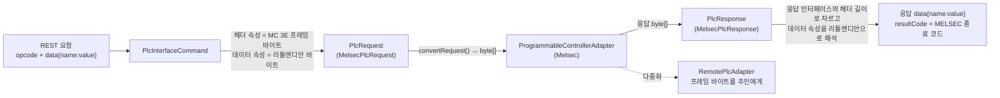
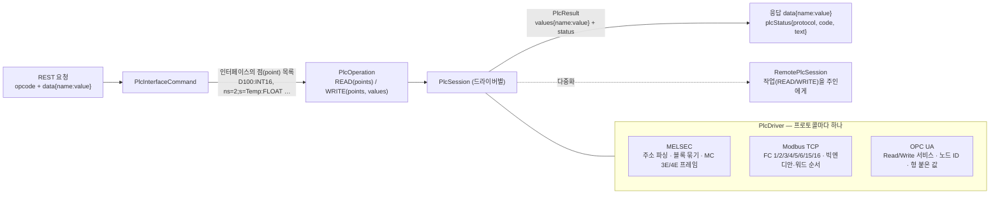

# PLC 프로토콜 일반화 설계 (MELSEC · Modbus TCP · OPC UA)

> 상태: **설계 확정** (2026-10-31, v0.3.0 — 결정 P1~P10 제안대로 확정). 대상: `wow-tc-backend/tc`, `vplc`, e2e.
> 할 일: [backend-todo.md](backend-todo.md) #12(PLC 보강), #13(Modbus·OPC UA). 프론트 재작성 전에 끝낸다 — 커넥터·인터페이스 화면이 이 모델 위에 선다.
> 관련: [dispatch-redesign.md](dispatch-redesign.md) §4·단계 7(값 코덱), [system-overview.md](system-overview.md) §1, [plc-ha-design.md](plc-ha-design.md) §3.1·§4(다중화 전달).

## 1. 목표와 범위

- **목표**
  - 같은 opcode·같은 REST·같은 전달·감사·다중화 위에서 **MELSEC, Modbus TCP, OPC UA** PLC 를 읽고 쓴다.
  - 사용자(운영자·화면)는 **프레임 바이트가 아니라 "어느 주소를 어떤 형으로"** 정의한다.
  - 지금 운영 중인 MELSEC 정의는 그대로 돈다(호환 모드). 새 정의부터 새 모델을 쓴다.
  - 프론트가 만들 API 계약(커넥터·인터페이스·시험 읽기)을 여기서 확정한다.
- **범위**
  - 1차: 공통 모델·드라이버 경계, MELSEC 을 새 모델로, MELSEC 보강(#12), Modbus TCP, 다중화 전달 계약 변경.
  - 2차: OPC UA 읽기·쓰기(구독은 3차). 1차 설계가 OPC UA 를 담을 수 있는지는 여기서 확인한다.
- **범위 밖**: OPC UA 구독·이벤트, MELSEC 시리얼(MC 1C 등), Modbus RTU(시리얼), PLC 프로그램 업·다운로드.

## 2. 지금 구조 — 무엇이 MELSEC 에 묶여 있나



| 어디 | MELSEC 에 묶인 것 | 근거 |
|---|---|---|
| 인터페이스 정의 | **요청 헤더 속성이 MC 3E 프레임 그대로** — 운영자가 `subHeader=5000`, `deviceCode=A8`, `startAddress=640000`(리틀엔디안 16진), `wordCount=0200`, `command=0104` 를 손으로 적는다 | e2e `fixture-if-read.json`, `HEADER_PROP` 표 |
| 응답 인터페이스 | 응답 헤더(`subHeader`…`resultCode`)의 바이트 길이로 응답을 자르고, 나머지를 데이터로 본다. 읽기 하나에 인터페이스 두 개(요청·응답)가 든다 | `MelsecPlcResponse.splitHeaderAndReplyData` |
| 값 변환 | 리틀엔디안 고정, `DOUBLE` 을 4바이트 float 로 읽음, 문자열 UTF-8 | `PlcResponse.extractReplypData`, `PropInfo.extractRealDataAsBytes` |
| 커넥터 정의 | `messageFrameFormat`(BINARY/ASCII), 요청·응답 헤더 템플릿, `memTypes`, 포트·VIP 쌍 | `PlcConnectorInfo` |
| 응답 | `resultCode` 가 MELSEC 종료 코드 | `TcMessageResponse` 주석 |
| 변경 감지 | 응답 원본 바이트 비교 | `PlcResponseService` |
| 다중화 | 인스턴스 사이 계약이 "요청 바이트 → 응답 바이트" | `RemotePlcAdapter`, `/internal/plc/{name}/exchange` |
| 시험 장비 | vplc 는 MC 3E 서버만 | `vplc/transport` |

**코드 점검에서 찾은 결함** (호환 모드에도 영향 — 1단계에서 함께 고친다)

| # | 결함 | 영향 |
|---|---|---|
| M1 | ASCII 프레임 조립이 `headers.get("oppornentIONumber")`(오타)를 읽는다 | ASCII 커넥터는 요청마다 NPE — 사실상 BINARY 만 동작 |
| M2 | 명령 검사 `cmd[0]!=0x01 && cmd[1]!=0x04` | `&&` 라 READ 인터페이스에 쓰기 명령(`0114`)이 와도 통과 |
| M3 | `wordCount`·`reqDataLen` 을 운영자가 헤더에 직접 적는다(WRITE 데이터 길이와 맞는지 확인 안 함) | 정의 실수가 PLC 오류 응답으로만 드러난다 |
| M4 | 응답 길이를 응답 인터페이스 정의로만 확인, 프레임의 `respDataLen` 을 보지 않음(#12 "응답 길이 검증") | 잘린·이어 붙은 프레임을 잘못 해석할 수 있다 |

## 3. 바꾼 뒤 구조



- **경계를 "바이트 프레임"에서 "작업(읽기·쓰기할 점과 값)"으로 올린다.** 프레임을 만들고 해석하는 일은 전부 드라이버 안이다.
- 명령(`PlcInterfaceCommand`)·디스패치·감사·결과 전달·변경 감지·스케줄은 프로토콜을 모른다.
- 다중화도 작업 단위로 넘긴다(§7) — OPC UA 는 바이트 프레임이 없다(세션·보안 채널 위의 서비스 호출).

## 4. 데이터 모델

### 4.1 커넥터

| 필드 | 공통/프로토콜 | 내용 |
|---|---|---|
| `name`, `description`, `status1`(의도), `connection`(실제) | 공통 | 지금과 같음 |
| `protocol` | 공통 | `MELSEC_MC`, `MODBUS_TCP`, `OPC_UA` |
| `host`, `ports`, `localVips` | 공통(OPC UA 는 `endpointUrl` 로 대신) | 채널 = 포트·VIP 쌍(지금과 같음). Modbus 도 같은 방식 |
| `requestTimeoutMs` | 공통(선택) | 비우면 `plc.request.timeout-ms` |
| `settings` | **프로토콜별 JSON**, 드라이버가 검증 | 아래 표 |

| 프로토콜 | `settings` |
|---|---|
| `MELSEC_MC` | `frame`(`3E_BINARY`·`3E_ASCII`·`4E_BINARY`), `networkNo`, `pcNo`, `ioNo`, `stationNo`, `monitoringTimer`(250ms 단위), `maxWordsPerRequest`(기본 960) |
| `MODBUS_TCP` | `unitId`(기본 1), `byteOrder`(기본 BIG), `wordOrder`(기본 BIG — 32비트 값의 워드 순서), `addressBase`(0 또는 1, 기본 1), `maxRegistersPerRequest`(기본 125), `maxCoilsPerRequest`(기본 2000), `healthCheckIntervalSec`(기본 30) |
| `OPC_UA` | `endpointUrl`, `securityPolicy`(None·Basic256Sha256 …), `securityMode`, `auth`(`anonymous`·`username`), `username`, `password`(암호화 저장 — `TC_SECRET_KEY`, DB 연결과 같은 방식), `sessionTimeoutMs` |

지금의 `messageFrameFormat`·헤더 템플릿·`memTypes` 는 MELSEC `settings` 로 옮긴다(§8 이전).

### 4.2 인터페이스

| 필드 | 내용 |
|---|---|
| `name`(opcode), `plcName`, `interfaceType`(READ·WRITE), `use`, 전달 정의 | 지금과 같음 |
| `mode` | `POINTS`(새 모델) · `RAW`(지금의 헤더·데이터 바이트 속성, MELSEC 만 — 호환) |
| `points` | `POINTS` 일 때. 아래 |
| `replyName`, `headerProps`, `dataProps`, `dataLength` | `RAW` 일 때만(지금과 같음) |

**점(point)** — 이름 하나에 값 하나(또는 배열)

| 필드 | 내용 | 예 |
|---|---|---|
| `name` | 요청·응답 `data` 의 키 | `d100`, `temp` |
| `address` | 프로토콜별 주소 문자열(드라이버가 파싱·검증) | MELSEC `D100`, `M10`, `W1A`, `ZR20000` · Modbus `HR40001`/`hr:0`, `IR30001`, `CO1`, `DI10001` · OPC UA `ns=2;s=Line1.Temp` |
| `type` | `BOOL`, `INT16`, `UINT16`, `INT32`, `UINT32`, `INT64`, `FLOAT32`, `FLOAT64`, `STRING`, `BYTES` | `INT16` |
| `count` | 배열 길이(기본 1) — 값이 JSON 배열이 된다 | 10 |
| `length` | `STRING`·`BYTES` 의 바이트 수 | 20 |
| `byteOrder`, `wordOrder` | 선택 — 커넥터 기본값을 이 점만 바꿀 때 | `LITTLE` |
| `description` | | |

- **READ** 인터페이스: 점들을 읽어 `data{name: value}` 로 돌려준다. 응답 인터페이스(`replyName`)가 필요 없다 — 읽기 하나 = 인터페이스 하나.
- **WRITE** 인터페이스: 요청 `data` 에서 점 이름의 값을 읽어 쓴다. 빠진 값은 400. 쓴 뒤 응답 `data` 는 비거나(기본) 다시 읽은 값(선택 `readBack`).
- 드라이버는 점들을 **연속 주소끼리 묶어** 요청 수를 줄인다(MELSEC 같은 디바이스·연속 워드, Modbus 같은 영역·한도 안). 묶기는 드라이버 일이라 정의에는 드러나지 않는다.

**예 — 지금의 `plc.e2e.d100.read`(요청·응답 인터페이스 두 개, 헤더 바이트 19개)가 이렇게 된다**

```json
{ "name": "plc.e2e.d100.read", "plcName": "plc-e2e", "interfaceType": "READ", "mode": "POINTS",
  "points": [ { "name": "d100", "address": "D100", "type": "INT16" },
              { "name": "d101", "address": "D101", "type": "INT16" } ] }
```

### 4.3 응답

```json
{ "success": true, "data": { "d100": 77, "d101": 1 },
  "plcStatus": { "protocol": "MELSEC_MC", "code": 0, "text": "OK" },
  "resultCode": 0, "resultDescription": "SUCCESS", "changed": true, "...": "..." }
```

- `plcStatus` 를 더한다 — MELSEC 종료 코드, Modbus 예외 코드(1~11), OPC UA StatusCode(32비트)와 이름.
- `resultCode`·`resultDescription` 은 남긴다(호환). MELSEC 은 지금과 같고, 다른 프로토콜은 `plcStatus.code` 와 같은 값.
- 실패는 지금처럼 `success=false`, `ERR_502_TC_PLC_ERROR`(PLC 가 오류로 답함) · `ERR_503`(연결 없음) · `ERR_504`(시간 초과). 점마다 상태가 다른 OPC UA 는 하나라도 나쁘면 실패, 점별 상태는 `plcStatus.points` 에.

## 5. 드라이버 경계

```java
public interface PlcDriver {                       // 프로토콜마다 Spring 빈 하나
    String protocol();                             // "MELSEC_MC" …
    void validateSettings(JsonNode settings) throws ToolControlException;      // 커넥터 등록·수정 때
    PlcAddress parseAddress(String address, PointType type, int count, int length) throws ToolControlException; // 인터페이스 등록 때
    PlcSession open(PlcConnectorInfo connector, PlcSessionListener listener) throws ToolControlException;       // 게시 때
}

public interface PlcSession {                      // 지금의 ProgrammableControllerAdapter 자리 — 연결·재연결·상태
    PlcResult read(List<PlcPoint> points, Deadline deadline) throws ToolControlException;
    PlcResult write(List<PlcPoint> points, Map<String, Object> values, Deadline deadline) throws ToolControlException;
    AdapterStatus status();
    void close();             // 이벤트 내고 닫기(해제)
    void closeQuietly();      // 앱 종료
    default boolean isLocal() { return true; }
}
```

- 연결 관리(채널·재연결·시간 초과·늦은 응답 버림·이벤트)는 지금 `MelsecProgrammableControllerAdapter` 가 가진 것을 **공통 `ChannelPool`** 로 떼어 MELSEC·Modbus 가 같이 쓴다(둘 다 TCP 요청·응답, 포트당 연결). OPC UA 는 라이브러리(Eclipse Milo) 세션을 쓴다.
- 값 변환은 **`ValueCodec`** — 형·바이트 순서·워드 순서만 알고 프로토콜은 모른다. MELSEC(리틀·워드 단위), Modbus(빅·레지스터 단위)가 같은 코덱을 설정만 달리 쓴다. OPC UA 는 형 붙은 값(Variant)을 바로 변환.
- `RAW` 모드는 지금의 `MelsecPlcRequest/Response` 를 MELSEC 드라이버 안에 그대로 두고 `PlcSession.exchangeRaw(byte[])` 로만 연다(호환 모드 전용).
- 커맨드 확장 지점(`beforeExchange`·`afterExchange`)은 유지하되 인자가 `PlcOperation`·`PlcResult` 로 바뀐다. 레거시 커스텀 커맨드 클래스는 지금 없음을 확인하고(운영 DB `CMD_CLASS_NAME`) 바꾼다.

## 6. 프로토콜별 요점

### 6.1 MELSEC MC (3E·4E)

| 항목 | 내용 |
|---|---|
| 주소 | 디바이스 기호 + 번호. 10진(D, M, R, ZR…)·16진(X, Y, B, W…) 디바이스 표를 드라이버가 가진다. 디바이스 코드(BINARY 1바이트·ASCII 2문자)는 표에서 |
| 명령 | 워드 일괄 읽기·쓰기(0401·1401, 서브 0000), 비트 디바이스는 서브 0001. 랜덤 읽기(0403)는 나중 |
| 값 | 리틀엔디안, 32비트는 연속 두 워드(하위 워드 먼저), 문자열은 워드당 2바이트 |
| 프레임 | 3E BINARY·ASCII(M1 고침), **4E**(#12 — 시리얼 번호로 응답을 요청과 맞춘다. 늦은 응답을 버릴 때 연결을 끊지 않아도 된다) |
| 응답 검증 | 프레임의 응답 데이터 길이(`respDataLen`)와 실제 길이, 종료 코드(#12, M4) |
| 연결 확인 | 주기적 **루프백 시험(0619)** 으로 반쯤 죽은 연결을 찾는다(#12 "주기적 연결 상태 확인"). 응답이 없으면 그 채널을 닫고 재연결 |

### 6.2 Modbus TCP

| 항목 | 내용 |
|---|---|
| 주소 | 영역 + 번호: 코일(`CO`, FC1·5·15), 입력 접점(`DI`, FC2), 입력 레지스터(`IR`, FC4), 보유 레지스터(`HR`, FC3·6·16). `HR100` 의 번호는 `addressBase`(기본 1 — `HR1` 이 프로토콜 주소 0)를 따르고, 5·6자리 관례 번호(`40001`·`300010`)는 늘 1부터 센다 |
| 값 | 레지스터 16비트 빅엔디안. 32·64비트의 **워드 순서는 장비마다 달라** 커넥터 기본값 + 점별로 바꾼다 |
| 프레임 | MBAP 헤더의 트랜잭션 ID 로 응답을 요청과 맞춘다(4E 와 같은 이점) |
| 오류 | 예외 응답(함수 코드 + 0x80, 예외 코드)을 `plcStatus` 로 |
| 채널 | 장비가 동시 연결 수를 제한하는 경우가 많다 — 포트당 연결 1개, 요청은 채널에서 차례로(지금 MELSEC 과 같음) |

### 6.3 OPC UA (2차)

| 항목 | 내용 |
|---|---|
| 주소 | 노드 ID 문자열(`ns=2;s=…`, `ns=3;i=1001`). 이름공간 URI 표기(`nsu=…;s=…`)도 받는다 |
| 값 | 서버가 형을 붙여 준다 — 점의 `type` 은 검증·변환용. 배열은 그대로 |
| 연결 | 세션·보안 채널(Eclipse Milo 클라이언트). 채널(포트·VIP) 개념이 없고 세션 하나에 요청을 병렬로 보낸다 |
| 오류 | 서비스·점별 StatusCode |
| 구독 | 3차 — 모니터 항목을 PUSH 인터페이스(`InterfaceType.PUSH`, 지금 쓰는 곳 없음)로 받아 전달 경로에 태운다 |
| 다중화 | 세션은 주인 인스턴스만 연다(임대 그대로). 다른 인스턴스는 작업 단위로 넘긴다(§7) |

## 7. 다중화 전달 계약 바꾸기

지금 `/internal/plc/{name}/exchange` 는 프레임 바이트를 넘긴다. OPC UA 에는 넘길 바이트가 없고, Modbus·MELSEC 도 점 묶기·응답 검증을 주인이 해야 한다. **작업 단위로 바꾼다.**

```
POST /internal/plc/{name}/execute
{ "op": "READ"|"WRITE"|"RAW", "points": [...], "values": {...}, "frame": "<base64, RAW 만>", "reqId": "...", "timeoutMs": 3000 }
→ 200 { "values": {...}, "status": {...}, "frame": "<base64, RAW 만>" } | 409 NOT_OWNER | 503 | 504
```

- 서명·포트·409 재시도·WRITE 재전송 금지 규칙은 그대로(plc-ha-design.md §4).
- 점 정의를 함께 보내 주인이 인터페이스를 다시 읽지 않는다(인스턴스 사이 설정이 잠깐 달라도 요청을 받은 쪽 정의대로).
- 순차 재기동 중 두 버전이 섞이므로 받는 쪽은 한동안 `/exchange` 도 받는다.

## 8. 이전 (지금 운영 정의)

| 대상 | 방법 |
|---|---|
| 커넥터 | migration: `PROTOCOL='MELSEC_MC'`, `SETTINGS_JSON` 에 프레임 형식·헤더 템플릿 값. 옛 칼럼은 남긴다(되돌리기용) |
| 인터페이스 | 그대로 `MODE='RAW'` 로 돈다 — 동작이 바뀌지 않는다 |
| RAW → POINTS 변환 | **변환 도구**(관리 API `POST /api/v1/ifsvc/management/{id}/convert-to-points`): 헤더에서 명령(0401·1401)·디바이스 코드·시작 주소·워드 수를 읽고, 응답 인터페이스의 데이터 속성(이름·형·길이)으로 점을 만든다. 알아볼 수 없으면 거절하고 사유를 돌려준다. 미리보기(`dryRun`) 후 적용, 설정 변경 이력에 남는다 |
| 응답 인터페이스 | POINTS 로 바꾼 인터페이스의 응답 인터페이스는 쓰는 곳이 없으면 정리(삭제는 운영자가) |
| 외부 계약 | 요청·응답 JSON(`data` 키·값)은 바뀌지 않는다 — 점 이름을 옛 데이터 속성 이름과 같게 만든다. 값의 형은 같다(INT16 ↔ SHORT) |

## 9. 시험

| 무엇 | 어떻게 |
|---|---|
| 코덱·주소 파서 | 단위 — 형·바이트·워드 순서 표, MELSEC 디바이스 표, Modbus 영역·기준 |
| MELSEC | vplc(MC 3E) e2e 그대로 + POINTS 인터페이스 + RAW→POINTS 변환 뒤 같은 값 + 4E·루프백(vplc 확장 필요 — §10 P6) |
| Modbus TCP | e2e 용 가짜 장비 — 파이썬 Modbus 서버(`fake_plc.py` 와 같은 자리). 워드 순서·예외 응답·연결 수 제한 |
| OPC UA | e2e 용 서버(파이썬 `asyncua` 또는 Milo 예제 서버) |
| 다중화 | `test_plc_remote.py` 를 `/execute` 로 — 세 프로토콜 |

## 10. 결정

**2026-10-31 확정 — P1~P10 모두 아래 제안대로.**

| # | 질문 | 결정 | 이유 |
|---|---|---|---|
| P1 | 지금 RAW 인터페이스 | **호환 모드로 계속 돌리고 변환 도구로 하나씩 옮긴다** | 일괄 자동 변환은 알아보지 못하는 정의에서 운영이 깨진다. 외부 계약은 같아 급하지 않다 |
| P2 | 점 저장 | **표 `INTERFACE_POINT`**(인터페이스 ID, 순서, 이름, 주소, 형, 개수, 길이, 순서 재정의) | 화면이 행 단위로 편집하고, 같은 주소를 쓰는 인터페이스 찾기(검색)가 쉽다. JSON 칼럼은 검색이 어렵다 |
| P3 | 주소 표기 | **프로토콜별 문자열**(`D100`, `HR40001`, `ns=2;s=…`) + 드라이버 검증 | 현장 문서·PLC 도구의 표기와 같다. 화면은 드라이버가 주는 디바이스 목록으로 도움말만 |
| P4 | 다중화 계약 | **작업 단위 `/execute`** (`/exchange` 는 전환 기간만) | OPC UA 를 담을 수 없는 계약을 미리 바꾼다 |
| P5 | 응답 상태 | **`plcStatus` 추가, `resultCode` 유지** | 외부 시스템이 지금 `resultCode` 를 본다 |
| P6 | 시험 장비 | **Modbus·OPC UA 는 e2e 파이썬 가짜 장비, vplc 는 MELSEC(4E·루프백 추가)만** | vplc 를 프로토콜마다 키우면 시험 장비가 제품만큼 커진다. 화면 시연용 Modbus 시뮬레이터가 필요해지면 그때 vplc 에 |
| P7 | OPC UA 시점 | **2차(프론트와 병행)**, 1차는 모델이 담는지만 확인 | 라이브러리·보안 설정이 무겁고, 화면은 1차 모델로 만들 수 있다 |
| P8 | 쓰기 뒤 응답 | **기본은 빈 `data`, 인터페이스 선택 `readBack`** | 쓰기 확인이 필요한 곳만 한 번 더 읽는다 |
| P9 | 커넥터 `settings` 저장 | **JSON 칼럼 `SETTINGS_JSON`**, 비밀값(OPC UA 비밀번호)은 암호화 | 프로토콜마다 필드가 달라 표로 나누면 프로토콜 수만큼 표가 는다. 검색할 일이 없다 |
| P10 | 변경 감지 | **값(`data`) 정규 JSON 비교**(RAW 는 지금처럼 바이트) | 프로토콜과 무관하고, 묶기 방식이 바뀌어도 같다 |

## 11. 순서

1. **모델·드라이버 경계 + MELSEC 이식**: `PlcDriver`·`PlcSession`·`ChannelPool`·`ValueCodec`, MELSEC 주소 파서·블록 묶기, POINTS 인터페이스·API(`INTERFACE_POINT`), 응답 `plcStatus`, 값 기반 변경 감지, 결함 M1~M3, RAW 호환. 커넥터 `protocol`·`settings` migration. — **완료(2026-10-31)**, §12.
2. **MELSEC 보강(#12)**: 4E 프레임, 응답 길이 검증(M4), 주기적 루프백, 포트 여러 개 병렬 연결 시험. vplc 4E·루프백. — **완료(2026-10-31)**, §13.
3. **Modbus TCP**: 드라이버·e2e 가짜 장비. — **완료(2026-10-31)**, §14.
4. **다중화 계약 `/execute`**, 변환 도구(RAW → POINTS). — **완료(2026-10-31)**, §15.
5. **API 계약 고정 → 프론트 재작성**(커넥터·인터페이스 화면은 이 모델로). 시험 읽기 API(`POST /api/v1/plc-connector/{name}/test-read`, 점 목록을 받아 바로 읽기)를 화면용으로 둔다.
6. **OPC UA**(2차, 프론트와 병행) → 구독(3차).

각 단계는 운영 중 MELSEC 정의(RAW)가 그대로 도는 상태로 끝난다 — 배포 사이에 끊김 없이 넘어갈 수 있게.

## 12. 1단계 구현 (2026-10-31)

### 12.1 만든 것

| 영역 | 내용 |
|---|---|
| 드라이버 경계 | `plc.protocol` 패키지 — `PlcDriver`(설정 정규화·점 검증·실행), `PlcOperation`(READ/WRITE, 점, 값, 커넥터 설정), `PlcResult`, `PlcStatus`, `FrameExchanger`, `ValueCodec`(형·바이트·워드 순서), `PlcDrivers`(프로토콜 → 드라이버) |
| MELSEC | `MelsecDriver` — 디바이스 표(28종, 진법), 주소 파서, 읽기 묶기(같은 디바이스, 빈 칸 8워드까지, `maxWordsPerRequest` 까지), 이어진 워드 쓰기 묶기, 비트 디바이스는 워드로 읽고 비트 단위(1401/0001)로 씀, 3E BINARY·ASCII 프레임, 응답 검증(서브헤더·길이 칸·종료 코드·데이터 길이 — M4) |
| 어댑터 | `ProgrammableControllerAdapter.execute(op)` 기본 구현 = 드라이버 + 자기 `exchangeFrame`. 로컬·원격(다중화) 어댑터가 같은 경로 — **POINTS 는 4단계(`/execute`) 전에도 다중화에서 동작** |
| 커넥터 | `protocol`(기본 `MELSEC_MC`), `settings`(JSON). 등록·수정 때 드라이버가 검증·기본값(`frame` 3E_BINARY, `pcNo` 0xFF, `ioNo` 0x03FF, `monitoringTimer` 0x10, `maxWordsPerRequest` 960 …, 16진 `0x…` 입력 가능). 설정이 없는 옛 커넥터는 옛 `messageFrameFormat` 으로 채운다. MELSEC 은 어댑터의 응답 해석기가 보는 `messageFrameFormat` 을 설정의 프레임과 맞춘다 |
| 인터페이스 | `mode`(RAW·POINTS, 비면 RAW), `points`(표 `INTERFACE_POINT`), `readBack`. 등록·수정 때 연결된 커넥터의 드라이버가 점을 검증(400). 수정 때 `points` 를 빼면 저장된 점 그대로, 주면 통째로 바꾼다 |
| 명령 | POINTS 면 응답 인터페이스 없이 `adapter.execute`. `data` = 값, `plcStatus`, `resultCode`(= 상태 코드), 값 정규 JSON 으로 변경 감지(P10), WRITE+readBack 이면 다시 읽기. RAW 응답에도 `plcStatus` |
| 결함 | M1(ASCII 오타), M2(명령 검사 → 409 `ERR_409_TC_INTERFACE_CONFIG`), M3(쓰기 데이터와 헤더 wordCount 불일치 → 409), M4(POINTS 응답 길이 검증) |
| 이전 | `migration/008_plc_protocol.sql` — 커넥터 `protocol`·`settings_json`, 인터페이스 `mode`·`read_back`, 표 `interface_point`. 기존 인터페이스는 RAW 그대로 |

### 12.2 구현하며 정한 것

- **드라이버는 상태 없는 일반 클래스, 정적 표로 찾는다** — 어댑터가 리플렉션으로 만들어져 Spring 빈을 받지 못하고, 원격 어댑터도 같은 드라이버를 써야 해서다. 커넥터 설정은 작업(`PlcOperation`)에 실어 보낸다.
- **`ChannelPool` 은 아직 떼지 않았다** — 두 번째 사용자(Modbus, 3단계)가 생길 때 뗀다. MELSEC 연결 관리는 지금 어댑터 그대로.
- **워드 디바이스의 비트(`D100.3`)는 아직 없다** — 쓰기가 읽고-고치고-쓰기(경합)라 따로 설계한다. 지금은 BOOL 을 비트 디바이스(M, X, Y, B …)에만 쓴다.
- **여러 프레임 쓰기는 원자적이지 않다** — 앞 프레임이 쓰인 뒤 다음 프레임에서 PLC 가 오류로 답하면 거기서 멈추고 오류를 돌려준다. 한 프레임 안(이어진 워드)은 PLC 가 한 번에 쓴다.
- **ZR 은 10진 번호**로 본다(GX Works 표기). 현장 PLC 기종에 따라 다르면 디바이스 표만 고친다.
- 점 이름은 `[A-Za-z_][A-Za-z0-9_.-]*`, 인터페이스마다 점 500개까지.

### 12.3 함께 고친 기존 결함

- **인터페이스 이름·일괄 삭제가 늘 500** — JPQL 일괄 `DELETE` 라 헤더·데이터 속성으로 cascade 되지 않아 외래 키 오류였다. 엔티티로 지우게 바꾸고 일괄 delete 쿼리를 지웠다(ID 삭제는 원래 됐다).

### 12.4 시험

- 단위 `ValueCodecTest`(형·바이트·워드 순서·배열·문자열·값 검증), `MelsecDriverTest`(주소, 점 검증, 설정, **D100 2워드 읽기 프레임이 RAW 정의와 같은 바이트**, 묶기, 비트 꺼내기, 쓰기 프레임 바이트, 종료 코드·길이 오류, ASCII 프레임).
- e2e `test_plc_points.py`(23) — RAW 와 같은 값, 여러 형 쓰기·readBack, 변경 감지, plcStatus, 등록·쓰기 값 검증, 커넥터 설정, M2, 삭제. `test_plc_remote.py` 에 POINTS 원격 읽기.
- **vplc 한계**: 만들지 않은 메모리 종류(시험 vplc 는 D 만)에는 답하지 않아 시간 초과가 난다(실제 PLC 는 오류 종료 코드). 비트 디바이스 e2e 는 vplc 에 M 메모리가 있을 때만 돌고, 비트 꺼내기는 단위 시험이 본다. vplc 는 비트 단위 쓰기·ASCII 응답 데이터도 지원하지 않는다 — 2단계(vplc 4E·루프백)에서 함께 손본다.

## 13. 2단계 구현 — MELSEC 보강 (2026-10-31)

### 13.1 tc

| 항목 | 내용 |
|---|---|
| 4E 프레임 | 설정 `frame` 에 `4E_BINARY`·`4E_ASCII`. 요청마다 채널이 일련번호를 매기고(`McFrames.setSerial`), 응답의 일련번호가 다르면 버린다. **4E 는 시간 초과에도 연결을 끊지 않는다** — 늦은 응답은 일련번호로 걸러진다(3E 는 지금처럼 끊고 다시 잇는다). 같은 연결에서 RAW(3E 헤더)와 POINTS(4E)가 섞여도 된다 — 응답은 서브헤더로 가린다 |
| 프레임 코드 | `McFrames`(공개) — 요청 조립(3E·4E, BINARY·ASCII), 일련번호, 응답 길이 계산(디코더·연결 시험이 같이 씀), 응답 해석, 루프백. 드라이버의 안쪽 클래스였던 것을 꺼냈다 |
| 응답 디코더 | `NettyMessageDecoder` 를 다시 썼다 — 서브헤더로 3E·4E 를 가리고 길이 칸만큼 자른다. 응답 머리가 아니면 버린다 |
| 주기적 연결 확인 | 설정 `healthCheckIntervalSec`(기본 30, 0 이면 끔). 쉬는 채널마다 루프백(0619 "ABCDE")을 보내 3초 안에 같은 데이터가 오지 않으면 그 채널을 닫는다(사유 `LOOPBACK_FAILED`) → 재연결. 요청 중인 채널은 건너뛴다. TCP 는 살아 있는데 PLC 가 답하지 않는 연결을 찾는다 |
| 끊김 사유 | 채널을 닫은 사유(`LOOPBACK_FAILED`·`TIMEOUT`)가 끊김 이벤트 cause 와 연결 상태의 `lastError` 에 남는다(예: `연결 끊김 127.0.0.1:15000 — 연결 확인(루프백)에 답이 없음`) |
| 연결 시험 | `test-connection` 이 (포트, VIP) 쌍마다 **동시에** TCP 연결 + 루프백까지 본다(예전: 첫 포트 TCP 만). 결과 `result` + `port:{포트}` 별 OK·사유. 게시 중이면 PLC 가 포트당 연결 하나만 받을 때 거부될 수 있다(안내 문구) |
| 응답 길이(M4) | POINTS 는 1단계에서. RAW 는 디코더가 길이 칸으로 자르고 응답 인터페이스 데이터 길이와 비교하므로 따로 더하지 않았다 |

### 13.2 함께 고친 결함

| # | 결함 | 영향 |
|---|---|---|
| M5 | tc 응답 디코더 ASCII 해석이 버퍼 배열을 직접 읽고, 길이 문자를 거꾸로 10진으로 읽고, 길이 검사가 늘 통과 | ASCII 커넥터는 응답을 한 번도 제대로 자르지 못했다(1단계의 M1 과 함께 ASCII 는 사실상 동작한 적이 없다) |
| V1 | vplc 이름으로 하는 제어(start·stop·pause·resume)가 id 대신 null 로 상태를 고쳐 늘 500 | 이름으로 가상 PLC 를 멈추고 재개할 수 없었다 |
| V2 | vplc 가 만들지 않은 메모리 종류에 답하지 않음 | tc 는 시간 초과(그리고 3E 면 연결 끊김)로만 알았다 → 이제 종료 코드 0xC056 |
| V3 | vplc 가 서브 명령을 보지 않음(비트 단위 요청도 워드로 처리), ASCII 응답에 데이터를 넣지 않음, 멈춤 상태에서 머리 없는 응답 | e2e fixture 의 `subCommand=0100`(비트 단위)이 D 워드 읽기로 통과하고 있었다 — fixture 를 `0000` 으로 고침(tc 템플릿 기본값은 원래 `0000`) |

### 13.3 vplc

- `McCodec`(요청 해석·응답 조립, 3E·4E, BINARY·ASCII) + `McResponder`(처리) — 예전 메시지 클래스 경로를 대신한다.
- 처리: 워드·비트 일괄 읽기(0401)·쓰기(1401), 루프백(0619). 만들지 않은 메모리·범위 밖 0xC056, 워드 디바이스를 비트 단위로 0xC05B, 모르는 명령 0xC059.
- 멈춤(PAUSED)이면 **답하지 않는다** — 연결은 살아 있는데 PLC 가 답하지 않는 상태를 흉내 낸다(시간 초과·루프백 시험용).

### 13.4 시험

- 단위 `McFramesTest`(4E 요청·일련번호, 응답 길이 3E·4E·BINARY·ASCII·붙어 온 프레임, 4E 해석, 루프백), `MelsecDriverTest` 갱신.
- e2e `test_plc_mc.py`(12) — vplc 오류 종료 코드, 포트별 연결 시험, 4E(POINTS 4E·RAW 3E 같은 값, 시간 초과에 연결 유지), 주기적 루프백(멈춘 vplc 연결 닫고 재개 뒤 다시 잇기). 정상 종료 포함 전체 e2e 통과.
- 남은 것: 실제 MELSEC PLC 로 4E·루프백 확인(vplc 는 규격대로 만들었을 뿐이다).

## 14. 3단계 구현 — Modbus TCP (2026-10-31)

### 14.1 TCP 공통 계층

MELSEC 어댑터에 들어 있던 연결 관리를 프로토콜과 떼어 Modbus 가 같이 쓴다.

| 것 | 내용 |
|---|---|
| `WireProtocol`(`plc.protocol`) | 프로토콜이 연결 계층에 알려 주는 것 — 응답을 어디서 자르는지(`responseLength`), 요청에 짝지을 번호가 있는지(`hasSerial`·`setSerial`·`serialOf`), 쉬는 연결 확인 프레임(`healthCheckRequest`·`healthCheckOk`). 드라이버가 설정으로 만든다(`PlcDriver.wire`) |
| `TcpPlcAdapter`(`plc.connector.tcp`) | 연결·재연결·채널 빌려 쓰기·시간 초과·주기적 연결 확인·이벤트. **번호가 있는 요청은 시간 초과에도 연결을 끊지 않는다**(MELSEC 4E·Modbus), 없으면(3E) 지금처럼 끊고 다시 잇는다. 하위 클래스는 프로토콜 이름과 RAW 처리만 정한다 |
| `TcpChannel`·`FrameDecoder`·`FrameEncoder` | 예전 `MelsecChannel`·`NettyMessageDecoder`·`NettyMessageEncoder` — 일련번호 대조와 응답 자르기를 `WireProtocol` 에 묻는다 |
| `MelsecProgrammableControllerAdapter` | `TcpPlcAdapter` 하위 클래스로 줄었다(RAW 요청·응답 객체만). DB 의 `adapterClassName` 때문에 이름은 그대로 |
| `McFrames` | `WireProtocol` 을 구현(4E 요청만 번호, 루프백). 정적 도우미 이름을 `setSerial4E`·`serial4EOf` 로 |
| 연결 시험 | 프로토콜의 연결 확인 프레임으로(MELSEC 루프백, Modbus 레지스터 읽기) |
| 끊김 사유 문구 | `연결 확인(루프백·시험 읽기)에 답이 없음` — 두 프로토콜 공통 |

### 14.2 Modbus TCP

| 항목 | 내용 |
|---|---|
| 드라이버 `ModbusDriver`(`MODBUS_TCP`) | 설정 §4.1(모르는 항목은 400). 영역 HR·IR 은 숫자·STRING·BYTES, CO·DI 는 BOOL 만. IR·DI 를 WRITE 인터페이스에 쓰면 400. 한 점은 125레지스터(쓰기 123)·2000비트(쓰기 1968)까지 |
| 읽기 | 같은 영역의 가까운 점끼리 한 번(빈 칸 8레지스터·16코일까지, 설정 상한까지). FC 1·2·3·4. 응답의 함수 코드·바이트 수·MBAP 길이 칸을 본다 |
| 쓰기 | 바로 이어진 점끼리 묶어 하나면 FC 6·5, 여럿이면 FC 16·15. 응답이 주소·개수(값)를 그대로 돌려주는지 본다. 프레임 사이는 원자적이지 않다(MELSEC 과 같음) |
| 값 | 바이트 순서 `byteOrder`, 32·64비트 워드 순서 `wordOrder`(CDAB 장비는 LITTLE), 점별 재정의. 코일은 낮은 비트가 첫 코일 |
| 예외 응답 | `plcStatus` = (`MODBUS_TCP`, 예외 코드, `Modbus 예외 코드 0x02 (잘못된 데이터 주소)`), `success=false`·`ERR_502_TC_PLC_ERROR`. 연결은 그대로 |
| 트랜잭션 ID | 채널이 요청마다 1~0xFFFF 를 넣는다 — 시간 초과에도 연결을 유지하고 늦은 응답은 버린다 |
| 연결 확인 | 쉬는 채널에 보유 레지스터 하나(주소 0) 읽기. 예외 응답이 와도 살아 있다고 본다(그 주소가 없는 장치) |
| 어댑터 `ModbusTcpAdapter` | POINTS 만. RAW 요청은 409, RAW 인터페이스 등록(READ·WRITE)은 400 |
| 커넥터 | `protocol: MODBUS_TCP` 로 등록하면 `adapterClassName` 이 `ModbusTcpAdapter` 로, `messageFrameFormat` 은 BINARY 로 정해진다. MELSEC 은 비었거나 Modbus 어댑터일 때만 MELSEC 어댑터로 바꾼다(옛 패키지 이름 행은 그대로) |
| 다중화 | 드라이버가 상태 없이 `FrameExchanger` 만 쓰므로 원격 어댑터(주인 인스턴스로 프레임 전달)가 그대로 된다 — 트랜잭션 ID 는 주인 쪽 채널이 넣는다 |

### 14.3 함께 고친 것

- 커넥터 조회가 `PORTS`·`CONNECTION_VIPS`·`MEM_TYPES` 가 NULL 이면 500 — 메모리 종류를 적지 않는 Modbus 커넥터에서 드러났다. 빈 목록으로 읽는다.

### 14.4 시험

- 단위 `ModbusDriverTest`(13) — 주소(영역+번호·Modicon·범위), 설정, 점 검증, 읽기 묶기·값(BIG·CDAB·문자열·코일), 예외 응답, 응답 검증, 쓰기(FC 6·16·5·15), 전송 규약(자르기·트랜잭션 ID·연결 확인).
- e2e `fake_modbus.py`(가짜 장치, 시험이 :15200 에 띄움) + `test_plc_modbus.py`(23) — 커넥터 자동 설정·연결 시험, RAW 거절, 읽기·쓰기(readBack), 워드 순서 LITTLE, 예외 응답, 시간 초과에 연결 유지, 쉬는 연결 확인으로 닫고 다시 잇기.
- 단위 93개, 정상 종료 포함 전체 e2e 통과(기본 모드). 두 인스턴스(소유권 켬)에서 test_plc_remote·test_plc_points·test_plc_modbus(A·B 양쪽으로) 통과, test_plc_ownership(한 대 시험) 통과. `test_plc_points` 의 "아직 없는 프로토콜" 예를 MODBUS_TCP → OPC_UA 로.
- 남은 것: 실제 Modbus 장비 확인, vplc 의 Modbus 서버(지금은 e2e 가짜 장치뿐).

## 15. 4단계 구현 — 다중화 계약 `/execute`, RAW → POINTS 변환 (2026-10-31)

### 15.1 `/execute`

```
POST /internal/plc/{name}/execute     (서명·포트·주인 확인은 /exchange 와 같다)
{ "op": "READ"|"WRITE", "protocol": "MODBUS_TCP", "settings": {...}, "points": [...], "values": {...}, "reqId": "...", "timeoutMs": 20000 }
→ 200 { "values": {...}, "status": { "protocol", "code", "text" } }
{ "op": "RAW", "frame": "<base64>", "reqId": "...", "timeoutMs": 20000 }
→ 200 { "frame": "<base64>" }
오류: 400(op·points 없음) · 409 ERR_409_TC_INTERFACE_CONFIG(점이 틀림) · 409 NOT_OWNER · 503 · 504 · 404(소유권 관리 꺼짐)
```

| 항목 | 내용 |
|---|---|
| 점·설정 | 요청을 받은 인스턴스가 보낸 점 정의와 커넥터 설정을 쓴다 — 주인은 인터페이스를 다시 읽지 않는다 |
| PLC 상태 | PLC 가 오류로 답해도 200 + `status`(code ≠ 0) — 보낸 쪽이 지금처럼 `success=false`·`plcStatus` 로 만든다 |
| 기다리는 시간 | RAW 는 PLC 시간 초과 + 2초. 점 작업은 주인이 묶은 프레임마다 시간 초과를 따로 세므로 `시간 초과 × min(점 수, 4) + 2초` |
| 순차 재기동 | 받는 쪽: `/exchange` 를 계속 받는다(옛 인스턴스가 보낸다). 보내는 쪽: `/execute` 가 404 면(옛 인스턴스) 3단계까지처럼 프레임마다 `/exchange` 로 넘긴다. 404 는 PLC 로 보내기 전이라 WRITE 도 안전하다 |
| 재전송 | 409 NOT_OWNER 만 주인을 다시 찾아 한 번(지금과 같음). 504·연결 오류는 다시 보내지 않는다 |

OPC UA(넘길 바이트가 없다)도 이 계약에 담긴다 — 6단계에서 드라이버만 더한다.

### 15.2 RAW → POINTS 변환

```
POST /api/v1/ifsvc/management/{id}/convert-to-points?dryRun=true|false        (권한 tc.interface U)
POST /api/v1/ifsvc/management/convert-to-points/byName/{name}?dryRun=true|false
→ 200 { name, dryRun, applied, points, warnings, replyName, replyUsedBy }
```

| 항목 | 내용 |
|---|---|
| 기본 | **미리보기**(`dryRun` 생략 = true) — 바꾸지 않고 만들 점과 경고만 |
| 머리 읽기 | 헤더 속성 바이트를 순서대로 이어 3E BINARY 요청 머리(21바이트)로 읽는다 — 속성 이름이 아니라 자리로 본다. 명령 0401(READ)·1401(WRITE), 서브 명령 0000(워드 단위), 디바이스 코드, 시작 번호, 워드 수 |
| 점 만들기 | 데이터 속성(읽기는 응답 인터페이스, 쓰기는 이 인터페이스)을 차례로 워드 자리에 놓는다. 이름은 데이터 속성 이름 그대로 — `data` 키가 바뀌지 않는다. SHORT(2)→INT16, INT(4)→INT32, LONG(8)→INT64, DOUBLE(4)→FLOAT32, STRING(n)→STRING n, BYTE(n)→BYTES n |
| 경고 | STRING(끝 NUL 을 뺌, 짧은 쓰기 값 허용), BYTE(Base64 → 16진 문자열 — 외부 시스템 확인 필요), 감시 타이머가 커넥터 설정으로 바뀜 |
| 거절(400, 사유) | 3E BINARY 가 아님(ASCII 헤더), 명령이 형과 맞지 않음, 비트 단위·비트 디바이스, 모르는 디바이스 코드, 워드 경계가 아닌 속성, 길이 합 ≠ 워드 수 × 2, 바꿀 수 없는 형(BOOLEAN, 길이가 다른 수), 네트워크·PC·I/O·국 번호가 커넥터 설정과 다름(POINTS 는 커넥터 설정으로 보낸다), MELSEC 커넥터가 아님, 이미 POINTS, READ·WRITE 가 아님 |
| 적용 | `mode=POINTS` + 점 저장, 변경 이력(UPDATE)에 남는다. **헤더·데이터 속성과 응답 인터페이스 이름은 그대로** — `mode` 를 RAW 로 되돌리면 예전대로 돈다 |
| 응답 인터페이스 | POINTS 는 쓰지 않는다. `replyUsedBy` 가 비면 지워도 된다(운영자가) |

### 15.3 시험

- 단위 `RawToPointsConverterTest`(6) — 읽기·쓰기, 여러 형·16진 디바이스, 거절 사유, 커넥터 경로 불일치, ASCII.
- e2e `test_plc_convert.py`(14) — 미리보기·적용·같은 opcode 같은 값(읽기·쓰기)·되돌리기·거절·404. `test_plc_remote.py` 에 `/execute` 직접 호출(READ·RAW·잘못된 op·잘못된 주소·주인 아님·서명 없음) 6개.
- 단위 99개, 정상 종료 포함 전체 e2e 통과. 두 인스턴스(소유권 켬, 서명 시험 포함)에서 test_plc_remote(17)·points·modbus·convert 를 A·B 양쪽으로 통과, test_plc_ownership(한 대) 통과.
- **섞인 버전**: 옛 jar(0.2.0, `/exchange` 만 — `/execute` 는 404)를 주인으로, 새 jar 를 다른 인스턴스로 띄워 새 인스턴스로 test_plc_points(23) 통과 — `/exchange` 대체 경로 확인.
- 함께 고친 것: 3E 에서 연결 확인이 시간 초과되면 끊김 사유가 "응답 시간 초과"로 남기도 했다(시간 초과로 닫는 사유와 연결 확인 사유가 경쟁). 연결 확인이 부를 때는 처음부터 LOOPBACK_FAILED 로 닫는다.
